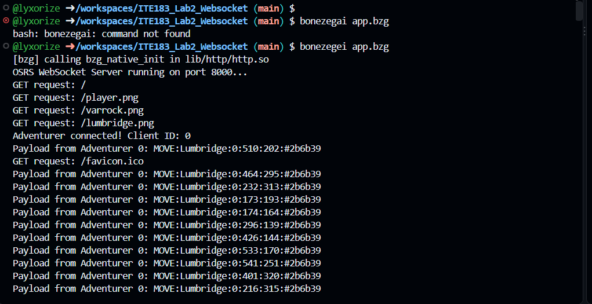
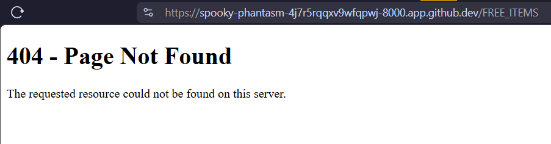
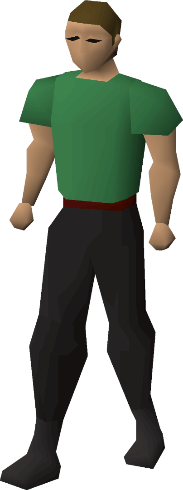

## ITE183 Lab 2: Event-Driven WebSocket Server (OSRS type BSL Realm)

By: R.A. Achacoso

A simple real-time, multi-client 2D social simulation and chat server constructed using the **Bonezegei Scripting Language (BSL v1.3.3)** HTTP and WebSocket framework.

---

## Repository Structure

```
ITE183_Lab2_Websocket/
├── .gitattributes         # GitHub syntax highlighting setup for *.bzg files
├── README.md              # Project overview and documentation
├── LICENSE                # MIT License
├── package.json           # Project manifest and BSL dependencies
├── app.bzg                # Core HTTP & WebSocket server implementation
└── public/                # Frontend web interface and assets
    ├── index.html         # Canvas client interface, teleport logic & WS chat
    ├── 404.html           # Custom 404 page for missing endpoints
    ├── player.png         # Player sprite image (To be added)
    ├── lumbridge.png      # Lumbridge background image (To be added)
    └── varrock.png        # Varrock background image (To be added)
```

## Prerequisites & Setup

### Download and install Bonezegei v1.3.3
```bash
wget https://github.com/bonezegei/Bonezegei_Scripting_Language/raw/refs/heads/main/Release/Latest/Bonezegei-x86.deb

sudo apt install ./Bonezegei-x86.deb
```
### Verify version installation
```bash
bonezegei -v
```
### Dependency Installation & Server Execution
```bash
bzg install http
bonezegei app.bzg
```

# Lab Documentation

## Verification & Screenshot Deliverables

Demonstrating successful installation of **Bonezegei v1.3.3**.


**Figure 1**: Terminal output showing version `1.3.3`.

## Server Startup



**Figure 2**: Successful active server startup on port 8000.

### Multi-Client Real-Time Interaction


**Figure 3**: Multi-client concurrent session testing demonstrating real-time local message broadcasting, username rendering, and character updates.

## Custom 404 Response Page



**Figure 4**: Custom `404.html` error page rendered for undefined path requests.

## Player Sprite



**Figure 5**: Adventurer.

## Conclusion
Through this laboratory module, full-duplex communication protocols and asynchronous socket event loops were successfully implemented using BSL v1.3.3. The project verified the utility of WebSockets for low-latency state synchronization across concurrent endpoints while demonstrating full HTTP static file serving and lifecycle error handling.